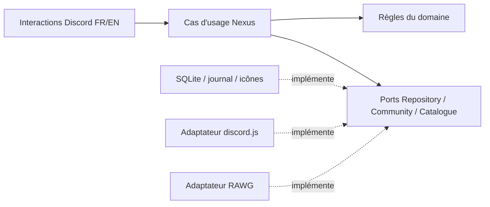

# Architecture et invariants

## Frontières

`domain/` contient les états, la politique d’inactivité et les droits métier. Il ne connaît ni Discord, ni SQLite, ni i18next. `application/` orchestre les opérations et dépend seulement des ports. `infrastructure/` fournit SQLite, RAWG, l’accès Discord et les images. `presentation/` transforme les interactions en cas d’usage et construit les écrans. `bootstrap.ts` compose ces éléments ; `main.ts` gère le cycle de vie et `cli.ts` les opérations explicites d’administration.

Le classement alphabétique des salons de la catégorie active relève de l'infrastructure Discord. `ActiveChannelOrder` regroupe pendant deux secondes les événements de création, suppression, renommage, déplacement et position ; le runtime demande aussi une vérification après chaque réconciliation réussie du runtime (démarrage et cycles périodiques). Le travail est sérialisé sous le mutex applicatif, drainé à l'arrêt et journalisé sans faire échouer une création de jeu si le tri échoue. Le prochain événement ou cycle périodique permet une nouvelle tentative. Tous les espaces textuels de la catégorie sont inclus, y compris forums et salons hors catalogue. Les positions sont normalisées en un seul appel uniquement si l'ordre visible diffère, avec un comparateur naturel insensible à la casse et aux accents et un départage stable par ID. Aucun parent ni aucune permission n'est transmis dans cet appel ; la consultation du catalogue et les CLI de diagnostic n'installent jamais ce traitement.

Le domaine reste volontairement petit : un agrégat Game, une identité UUID interne, une identité RAWG optionnelle et des références Discord uniques. Des IDs de rôle et de salon sont des références, pas l’identité du jeu. Les abonnements sont un concept indépendant de l’activité et de la visibilité du salon.

## Événements autonomes

`CommunityEvent` porte son salon, son rôle, le message épinglé et les dates de clôture/archivage. Le jeu associé est une référence informative avec nom conservé ; il n’entraîne aucune cascade de rotation, quota, abonnement ou activité. Les tables additives `community_events` et `event_operations` sont créées par la migration `003`. Les ressources événementielles sont reconnues par l’audit et le statut admin sans entrer dans le recyclage des rôles de jeux.

`EventService` dépend de `Repository` et `EventCommunity` et partage le mutex Nexus et le bail du runtime. L’adaptateur Discord événementiel lit les salons, rôles et références de permissions sans charger les détenteurs de tous les rôles. Les confirmations expirent après cinq minutes ; leur empreinte couvre les cibles et capacités pertinentes, sans les abonnements étrangers à l’action. Chaque mutation a un reçu préalable et les IDs confirmés sont enregistrés à chaque étape. Une reprise est toujours une opération admin explicite, jamais un rejeu au démarrage.

La clôture retire l’accès avant le déplacement et conserve un état fermé si le rangement échoue. Le nettoyage vise un salon archivé précis, revérifié avant suppression ; il n’autorise aucune suppression supplémentaire après une erreur. Les corrélations d’événements et opérations non résolues restent conservées, les opérations terminées expirent après trente jours. Une création incertaine peut être corrélée par le marqueur du salon, le journal d’audit des ressources créées ou une recherche bornée du message ; l’absence de preuve conduit à une vérification manuelle.

`EventController` acquitte avant réseau ou verrou, ouvre les modales sans attendre une lecture Discord et vérifie les droits actuels avant mutation. Les réponses privées sont sérialisées par message et invalidées lors d’une navigation plus récente, y compris entre le hub admin et les événements. Les contrôles publics portent l’identité durable de l’événement, les contrôles privés utilisent des sessions liées à leur propriétaire. Les textes FR/EN et mentions autorisées sont explicites sur les messages, modifications et publications de forum.

La catégorie des événements est initialisée uniquement par une création confirmée. Sa position et sa visibilité changent lors des opérations admin, sans recréation d’une catégorie supprimée. Un second `ActiveChannelOrder` lit son ID persistant à la demande et maintient seulement l’ordre alphabétique de ses salons textuels, avec les mêmes déclencheurs et protections que les jeux.

## États et horloges

Un jeu est `active`, `archived` ou `unavailable`. Son rôle est `present`, `recycled` ou `missing`. `blocked` suspend les actions et la rotation en cas de doute ; `retired` le retire du catalogue sans supprimer ses ressources.

La création et la relance ouvrent un délai provisoire de 48 heures. Seul un message humain postérieur ou égal à l’activation le termine. Un message antérieur retrouvé dans l’historique ne valide pas une nouvelle relance. Dans le régime normal, la dernière activité humaine détermine les 30 jours. Les quinze jeux normaux les plus récents sont protégés. Le bot ne crée pas artificiellement quinze jeux si le catalogue initial n’en contient pas quinze établis.

Les forums et fils sont rattachés au salon principal. Les scans de rattrapage vérifient aussi les fils archivés. Les parcours sont bornés ; un historique non entièrement vérifiable empêche l’archivage concerné. Une absence de permission de lecture n’est jamais assimilée à une absence d’activité.

## Cohérence et reprise

Les mutations des interactions, la rotation et l’enregistrement durable d’activité passent par un mutex de l’application. Les scans d’historique de réconciliation et les diagnostics lisent hors de ce verrou ; les scans de réconciliation sont sérialisés séparément. Après les historiques, un inventaire Discord frais précède l’application ; si une mutation a terminé pendant cet inventaire ou son attente du verrou, il est relu sous verrou. Une observation d’historique n’est réutilisée que pour le même salon et la même activation. Les changements observés des jeux, abonnements et date de réconciliation sont enregistrés en une transaction afin d’éviter un commit disque bloquant par jeu. Une activité humaine établie encore dans les trente jours évite une lecture d’historique inutile ; les activations provisoires restent vérifiées. Les activités humaines reçues sont mémorisées avant toute attente et revérifiées avant les permissions puis après les appels de déplacement d’un archivage automatique. Si une activité arrive pendant ces appels, cet archivage est annulé en restaurant son parent et ses permissions d’origine ; un échec de cette restauration reste à vérifier. Les créations RAWG préparent leur visuel hors verrou et réutilisent celui de leur aperçu. Les droits sont relus après l’attente du verrou, et l’auto-abonnement vérifie aussi le membre de sa dernière lecture REST. La restauration explicite des préférences d’un rôle recyclé conserve sa règle distincte : seuls les membres encore présents dans Discord sont réabonnés. Un bail SQL de 60 secondes renouvelé toutes les dix secondes empêche deux instances d’écrire simultanément via les commandes prises en charge. Ce n’est pas une architecture distribuée : un seul volume local et une seule instance sont attendus. Ne pas partager la base sur NFS.

Un journal précède chaque création, déplacement, import et recyclage. Les IDs confirmés sont persistés au fil des appels. Discord et SQLite ne partagent pas de transaction ; aucune garantie « exactement une fois » n’est revendiquée. Les salons créés portent un marqueur UUID dans le sujet. Un crash peut ainsi laisser une création récupérable ; une ambiguïté ou une erreur de permissions exige une réparation explicite. Nexus ne supprime jamais un salon pour compenser un échec.

La réconciliation exige un inventaire complet avant de remplacer les abonnements ou de décider une rotation. La lecture des membres utilise l’API REST paginée, avec 1 000 membres maximum par page, un curseur croissant et des données fraîches à chaque inventaire. Une page en échec ou un curseur incohérent interrompt la lecture ; un nombre de membres insuffisant maintient l’inventaire incomplet. La confidentialité du panneau staff utilise la même lecture. Les requêtes ciblées de droits restent forcées depuis Discord à chaque mutation. Cette approche respecte la limite Gateway d’une demande complète par serveur et par bot toutes les trente secondes. Voir [List Guild Members](https://docs.discord.com/developers/resources/guild#list-guild-members) et [la limite Gateway](https://docs.discord.com/developers/change-log#august-14-2025). Elle suit les catégories et rôles observés. Une suppression manuelle de rôle invalide les abonnements observés et exige une décision admin, contrairement au recyclage intentionnel qui conserve les préférences. Une opération de réactivation interrompue n’est pas rejouée aveuglément pour réattribuer des rôles.

Une panne au moment exact où une catégorie d’archive est créée peut laisser une catégorie vide non enregistrée. La diagnostiquer via l’inventaire ; ne pas adopter automatiquement une catégorie portant seulement un nom ressemblant. Les erreurs explicites et opérations importées partielles restent bloquées jusqu’à réparation.

## Permissions et recyclage

Les salons gérés utilisent des dérogations standard : invisibles à `@everyone`, visibles aux Syndiqués lorsqu’actifs, invisibles aux Syndiqués lorsqu’archivés ; bot et admins gardent l’accès. Les dérogations héritées sont sauvegardées avant un déplacement, puis remplacées. Les rôles de jeux ne portent aucun droit global et ne contrôlent pas la visibilité des jeux actifs. La préparation et l’application d’une réparation refusent les rôles réservés (serveur, Syndiqués, admins, nouveautés), les ressources des événements et leurs corrélations non résolues. Ces rôles sont aussi exclus du recyclage automatique.

Sous pression de la limite de rôles, seul un rôle archivé explicitement recyclable, ordinaire, sous le bot, sans permission globale ni référence dans une dérogation ou le questionnaire peut être retiré. Le snapshot sauvegarde ses détenteurs avant suppression. Les imports historiques sont non recyclables : d’éventuels usages externes ou intégrations inconnues ne peuvent pas être déduits de l’API Discord.

Les autorisations sont vérifiées côté serveur et actualisées pour les mutations. Les sessions personnelles sont opaques, liées à leur propriétaire et expirent après quinze minutes. Un résultat de recherche est sélectionné par son ID fournisseur ; Nexus n’assimile pas le premier homonyme à une correspondance exacte.

## Limites de cette V1

- Les doublons historiques exigent un choix admin de salon canonique. Discord ne propose pas de fusion native conservant intégralement auteurs, dates et liens des messages. Les autres salons restent conservés et hors gestion.
- Les canaux vocaux restent hors périmètre.
- L’icône vient du visuel fournisseur ou d’une validation admin ; son sens ou sa qualité ne peut pas être garanti automatiquement.
- Les modifications manuelles de permissions ne sont pas corrigées en boucle. Les mouvements gérés et réparations explicites réappliquent les dérogations standard.
- L’état `unhealthy` expose une panne ; le redémarrage et l’alerte d’infrastructure appartiennent à l’hébergeur.
- Les tests locaux et Docker ne remplacent pas un essai sur une guilde dédiée avec les permissions et options réelles du serveur cible.

## Parcours Discord

`Views` produit des messages Components V2 (containers, textes, sections, boutons et médias). Les créations n’envoient ni `content` ni `embeds` ; `editView` les vide explicitement lors d’une modification, notamment pour convertir un ancien panneau. Les images jointes sont référencées par une miniature ou une galerie. Les réponses d’erreur et de confirmation gardent ce format, car le flag V2 ne peut pas être retiré.

Les sessions personnelles de 15 minutes conservent une destination de retour typée (catalogue avec filtre/recherche/page, accueil, liste ou détail de demande). Les identifiants sont liés au membre ; chaque retour relit les données actuelles. Les boutons publics sans session ouvrent une réponse éphémère. Une modale issue d’un message privé met à jour ce message ; une modale issue du panneau public crée une réponse éphémère pour préserver le panneau partagé. Les modales utilisent des Labels et un texte d’aide ; la fermeture native retrouve le message d’origine.

Références Discord : [Components V2](https://docs.discord.com/developers/components/reference), [modales](https://docs.discord.com/developers/components/using-modal-components), [conversion d’un message existant](https://docs.discord.com/developers/resources/message#edit-message). Les tests sérialisent les builders réels, vérifient les limites Discord et couvrent les retours, les soumissions privées/publiques et la mise à jour du panneau sans doublon.

## Administration centralisée (1.0.1)

`AdminController` et `AdminViews` constituent le parcours privé Components V2. `Administration` prépare les confirmations et les diagnostics en lecture seule, puis appelle les cas d’usage de `Nexus`. Les garde-fous s’exécutent sous le même mutex que la mutation : propriétaire et durée de validité du plan, état applicatif, inventaire Discord et confirmation non déjà consommée. Les doubles clics et confirmations concurrentes ne peuvent pas rejouer la même opération. Les sessions conservent leurs filtres et destinations de retour.

Le diagnostic partage les règles du domaine pour les candidats à l’archivage et ne prend jamais `synchronize(false)` pour une lecture seule. La réconciliation manuelle utilise ce dernier mode seulement après confirmation ; la rotation reste une autre décision. Les prévisualisations sont revérifiées avant application. Leur empreinte couvre les associations, permissions et capacités pertinentes pour chaque action ; les abonnements ou arrivées de membres sans rapport n’invalident pas une action sur un jeu. Les refus, demandes de précision et autres mutations purement applicatives ne chargent pas un inventaire complet des membres. La confirmation d’une rotation réutilise les historiques de son scan au lieu de les relire sous verrou. Le rôle admin est actualisé pour les pages privées et avant les mutations ; les validations de formulaire servent seulement à préparer un récapitulatif.

L’ajout manuel admin et l’approbation utilisent le journal de création existant, avec acteur admin et bénéficiaire distincts. Les admins contournent le quota membre, pas les capacités ou permissions. L’archivage manuel et le renommage Discord sont journalisés ; un renommage partiel exige une vérification explicite. Le retrait logique conserve les ressources et les références historiques. Les uploads Discord éphémères sont téléchargés depuis les seules origines autorisées, validés, adaptés et conservés en BLOB avant confirmation. Les sessions protègent leurs assets contre le nettoyage normal.

Le bootstrap explicite enregistre les deux commandes d’entrée sans sous-commandes d’administration et le raccourci privé `/nexus-status` et installe les messages membre/staff. Le panneau staff est publié dans un salon déjà privé, sans changer ses permissions. Une action de publication dans le panneau admin vérifie aussi les permissions du salon cible entre l’aperçu et la confirmation. Le format V2 est conservé lors des déplacements. La migration de données `002` préserve les dates d’ajout connues ; aucune migration déjà appliquée n’est modifiée.

Les demandes portent des dates de dernière mise à jour et de clôture ; les opérations portent une date de fin. Sous le mutex applicatif, le nettoyage expire les demandes ouvertes après trente jours d’inactivité. SQLite purge les demandes trente jours après leur clôture, les opérations terminées ou échouées trente jours après leur fin et les entrées d’audit trente jours après leur écriture. Les opérations en attente ou à vérifier restent conservées. Les anciens enregistrements sans ces dates utilisent un point de départ de rétention mémorisé au déploiement. Ces champs JSON optionnels ne changent pas le schéma SQL. Le nettoyage précède chaque réconciliation périodique et conserve les données de catalogue et les reçus d’import nécessaires à l’idempotence.

Le diagnostic expose une progression applicative indépendante de Discord et de la localisation : préparation, lecture des ressources, puis jeux vérifiés. Il ne monopolise pas le mutex des mutations ; une révision pertinente changée pendant sa lecture invalide son résultat. La présentation met immédiatement à jour le message après acquittement et espace les mises à jour de progression. Le composant `Replies`, partagé entre les contrôleurs membre, admin et événements, associe à chaque message personnel une génération de navigation et une file d’éditions. Une réponse ancienne ne peut plus remplacer la page courante, y compris lors du passage entre contrôleurs et lorsqu’une ancienne édition HTTP est déjà en vol. Les actions membre longues affichent leur attente dans ce même message. Changer de menu annule les lectures restantes du diagnostic via un signal contrôlé entre les appels réseau, sans annuler une mutation administrative déjà confirmée. Ces générations sont isolées par membre/message et expirent après quinze minutes.

## Ajouts et annonces

`Game.addedAt` est une date JSON optionnelle de première création réussie, distincte de `activatedAt`. Une réimportation conserve cette valeur ; une relance ne la change pas. La migration `002` récupère les dates des opérations `create` terminées, avant leur purge normale, et laisse les autres dates inconnues (`null`). Les vues ne déduisent jamais cette date de l’âge du salon Discord ni de la dernière activité. Le filtre `recent` utilise cette date et un ordre stable, tout en conservant pagination, recherche et destination de retour.

Le réglage des alertes utilise les ports de lecture et d’attribution de rôle existants, avec autorisation membre et observation fraîche avant mutation. Discord reste la référence ; aucun abonnement global en SQLite n’est rejoué et aucun rôle n’est créé. L’infrastructure refuse un rôle géré, privilégié ou impossible à attribuer.

Une création réussie enregistre atomiquement le jeu, sa date, l’opération terminée et une annonce `pending` dans les métadonnées. Le port `announceNewGame` publie une annonce bilingue dans le salon configuré en autorisant la seule mention du rôle d’alertes. Un nonce stable avec `enforceNonce` protège aussi les retries internes à Discord.js. L’état passe à `sending` avant l’appel, puis `sent` avec l’ID du message. Tout résultat incertain devient `review`, sans renvoi automatique ; la création reste réussie. Au redémarrage, seuls les envois durablement `pending` sont tentés. Le runtime traite cette file après réconciliation ; les diagnostics et l’import ne la publient pas. Une création interrompue reconnue comme terminée ne prépare une annonce que si son opération l’avait explicitement prévu. Les envois confirmés expirent après trente jours, les états non résolus sont conservés.

Les erreurs `GatewayRateLimitError` conservent leur type, opcode et délai de reprise dans les journaux Pino. Les données de requête, recherches de membres et nonces restent exclues. Les parcours membre et admin affichent un délai localisé lorsqu’une telle limite survient ; les phases du panneau distinguent lecture des permissions, préparation du plan, consommation de la confirmation et publication.
