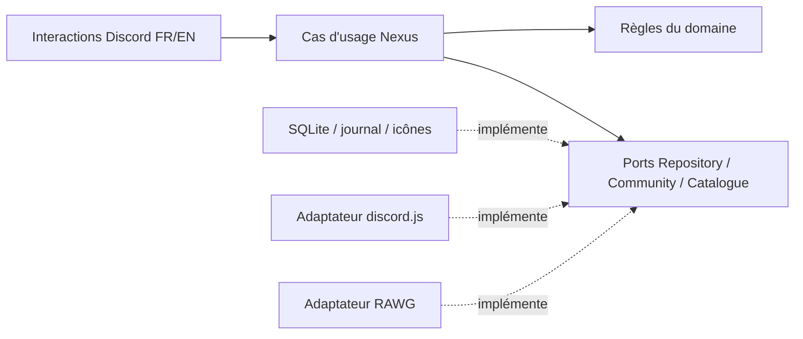

# Architecture et invariants

## Frontières

`domain/` contient les états, la politique d’inactivité et les droits métier. Il ne connaît ni Discord, ni SQLite, ni i18next. `application/` orchestre les opérations et dépend seulement des ports. `infrastructure/` fournit SQLite, RAWG, l’accès Discord et les images. `presentation/` transforme les interactions en cas d’usage et construit les écrans. `bootstrap.ts` compose ces éléments ; `main.ts` gère le cycle de vie et `cli.ts` les opérations explicites d’administration.

Le domaine reste volontairement petit : un agrégat Game, une identité UUID interne, une identité RAWG optionnelle et des références Discord uniques. Des IDs de rôle et de salon sont des références, pas l’identité du jeu. Les abonnements sont un concept indépendant de l’activité et de la visibilité du salon.

## États et horloges

Un jeu est `active`, `archived` ou `unavailable`. Son rôle est `present`, `recycled` ou `missing`. `blocked` suspend les actions et la rotation en cas de doute ; `retired` le retire du catalogue sans supprimer ses ressources.

La création et la relance ouvrent un délai provisoire de 48 heures. Seul un message humain postérieur ou égal à l’activation le termine. Un message antérieur retrouvé dans l’historique ne valide pas une nouvelle relance. Dans le régime normal, la dernière activité humaine détermine les 30 jours. Les quinze jeux normaux les plus récents sont protégés. Le bot ne crée pas artificiellement quinze jeux si le catalogue initial n’en contient pas quinze établis.

Les forums et fils sont rattachés au salon principal. Les scans de rattrapage vérifient aussi les fils archivés. Les parcours sont bornés ; un historique non entièrement vérifiable empêche l’archivage concerné. Une absence de permission de lecture n’est jamais assimilée à une absence d’activité.

## Cohérence et reprise

Les interactions, la rotation et l’enregistrement d’activité passent par un mutex de l’application. Un bail SQL de 60 secondes renouvelé toutes les dix secondes empêche deux instances d’écrire simultanément via les commandes prises en charge. Ce n’est pas une architecture distribuée : un seul volume local et une seule instance sont attendus. Ne pas partager la base sur NFS.

Un journal précède chaque création, déplacement, import et recyclage. Les IDs confirmés sont persistés au fil des appels. Discord et SQLite ne partagent pas de transaction ; aucune garantie « exactement une fois » n’est revendiquée. Les salons créés portent un marqueur UUID dans le sujet. Un crash peut ainsi laisser une création récupérable ; une ambiguïté ou une erreur de permissions exige une réparation explicite. Nexus ne supprime jamais un salon pour compenser un échec.

La réconciliation exige un inventaire complet avant de remplacer les abonnements ou de décider une rotation. Elle suit les catégories et rôles observés. Une suppression manuelle de rôle invalide les abonnements observés et exige une décision admin, contrairement au recyclage intentionnel qui conserve les préférences. Une opération de réactivation interrompue n’est pas rejouée aveuglément pour réattribuer des rôles.

Une panne au moment exact où une catégorie d’archive est créée peut laisser une catégorie vide non enregistrée. La diagnostiquer via l’inventaire ; ne pas adopter automatiquement une catégorie portant seulement un nom ressemblant. Les erreurs explicites et opérations importées partielles restent bloquées jusqu’à réparation.

## Permissions et recyclage

Les salons gérés utilisent des dérogations standard : invisibles à `@everyone`, visibles aux Syndiqués lorsqu’actifs, invisibles aux Syndiqués lorsqu’archivés ; bot et admins gardent l’accès. Les dérogations héritées sont sauvegardées avant un déplacement, puis remplacées. Les rôles de jeux ne portent aucun droit global et ne contrôlent pas la visibilité des jeux actifs.

Sous pression de la limite de rôles, seul un rôle archivé explicitement recyclable, ordinaire, sous le bot, sans permission globale ni référence dans une dérogation ou le questionnaire peut être retiré. Le snapshot sauvegarde ses détenteurs avant suppression. Les imports historiques sont non recyclables : d’éventuels usages externes ou intégrations inconnues ne peuvent pas être déduits de l’API Discord.

Les autorisations sont vérifiées côté serveur et actualisées pour les mutations. Les sessions personnelles sont opaques, liées à leur propriétaire et expirent après quinze minutes. Un résultat de recherche est sélectionné par son ID fournisseur ; Nexus n’assimile pas le premier homonyme à une correspondance exacte.

## Limites de cette V1

- Les doublons historiques exigent un choix admin de salon canonique. Discord ne propose pas de fusion native conservant intégralement auteurs, dates et liens des messages. Les autres salons restent conservés et hors gestion.
- Les évènements et canaux vocaux restent hors périmètre.
- L’icône vient du visuel fournisseur ou d’une validation admin ; son sens ou sa qualité ne peut pas être garanti automatiquement.
- Les modifications manuelles de permissions ne sont pas corrigées en boucle. Les mouvements gérés et réparations explicites réappliquent les dérogations standard.
- L’état `unhealthy` expose une panne ; le redémarrage et l’alerte d’infrastructure appartiennent à l’hébergeur.
- Les tests locaux et Docker ne remplacent pas un essai sur une guilde dédiée avec les permissions et options réelles du serveur cible.
